# Hi, everyone! 👋

I'm a Senior Flutter Engineer based in Indonesia, with 8+ years in software development and Flutter as my main stack since 2019. I also work in native Kotlin and Swift and in React Native, and I've done web work in Next.js with some backend fixes in Go.

I led the Flutter migration of Teman Bumil, replacing its separate native Android and iOS codebases with one app (1M+ downloads, 150K MAU, 99.5% crash-free sessions). At Bosshire I built the Flutter job portal from concept to launch (10K+ downloads, 2.5K MAU, 4.8/5 rating on Google Play and the App Store).

I mostly work with Clean Architecture, BLoC/Cubit, unit tests, and TDD on business logic. Claude Code is part of my daily workflow, and it helped increase release velocity by 30% at Bosshire. I like digging into production issues with Crashlytics and Flutter DevTools.

I led a squad of 5 mobile engineers, then managed a 24-person product engineering team as Technology Manager. At Bosshire I led an 8-person cross-functional team and was also its only mobile engineer.

My open-source Flutter Enterprise Starter Kit has 50+ GitHub stars. I'm open to remote roles with global teams.

Find my personal portfolio [here](https://nicolin.dev) or connect with me on [LinkedIn](https://www.linkedin.com/in/nicodemus-lin/).

---

## Tech Experiences

---

## Featured Open Source Projects

### [Flutter Enterprise Starter Kit](https://github.com/nicolinx/flutter_enterprise_starter_kit)
A production-oriented Flutter starter kit with Clean Architecture, Cubit, dependency injection, Firebase Authentication, and typed error handling. It has 50+ GitHub stars.
- **Architecture:** Clean Architecture + Cubit, feature-based modules, decisions and trade-offs documented in the repo
- **Features:** Offline REST caching, Dev/Prod flavors, Fastlane, Firebase App Distribution
- **Testing:** Automated tests with Mockito, GitHub Actions CI

### [Character Lens](https://github.com/nicolinx/character-lens)
A Flutter app where you draw a Chinese or Japanese character with your finger and look it up. Handwriting is recognized on the device, readings and meanings come from an offline dictionary, and a separate AI-generated card explains the character.
- **Architecture:** Clean Architecture + Riverpod with sealed states, documented in ADRs and a [case study](https://github.com/nicolinx/character-lens/blob/main/docs/case-study.md)
- **Features:** On-device ML Kit Digital Ink, offline Unihan SQLite dictionary (60,183 characters), Gemini via Firebase AI Logic with App Check and a reading validator
- **Testing:** 630 tests, GitHub Actions CI

---

## GitHub Overview

  

    
    
  

  

    
  

---

## My GitHub Contributions

  <picture>
    <source media="(prefers-color-scheme: dark)" srcset="https://raw.githubusercontent.com/nicolinx/nicolinx/output/github-contribution-grid-snake-dark.svg">
    <source media="(prefers-color-scheme: light)" srcset="https://raw.githubusercontent.com/nicolinx/nicolinx/output/github-contribution-grid-snake.svg">
    
  </picture>

---

© 2026 [Nicodemus Lin](https://nicolin.dev)
