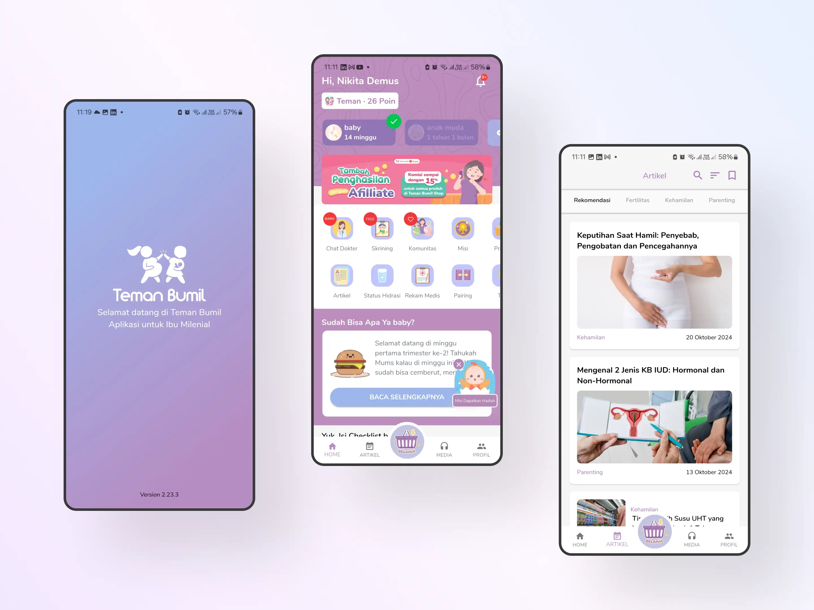
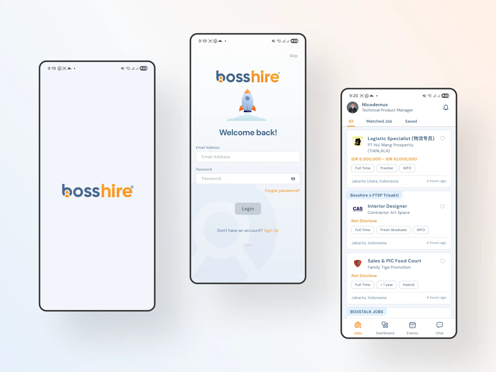
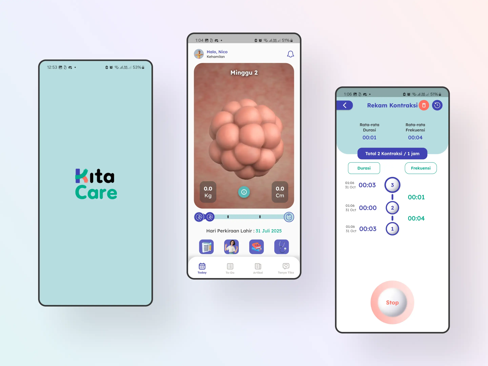
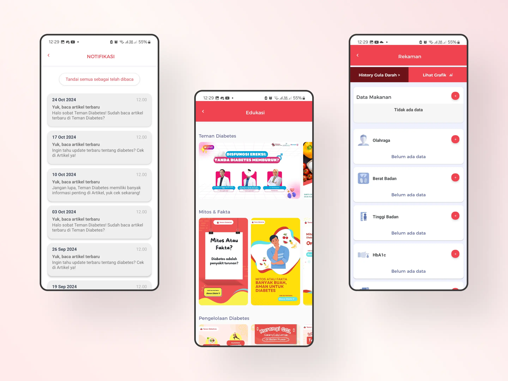
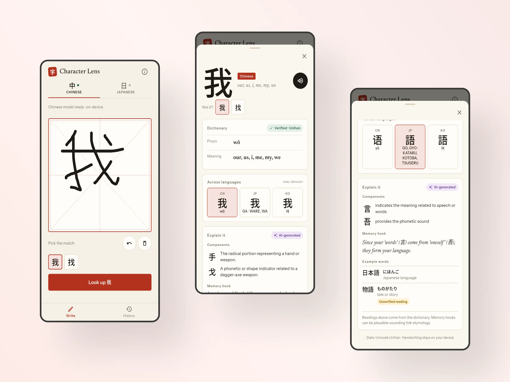
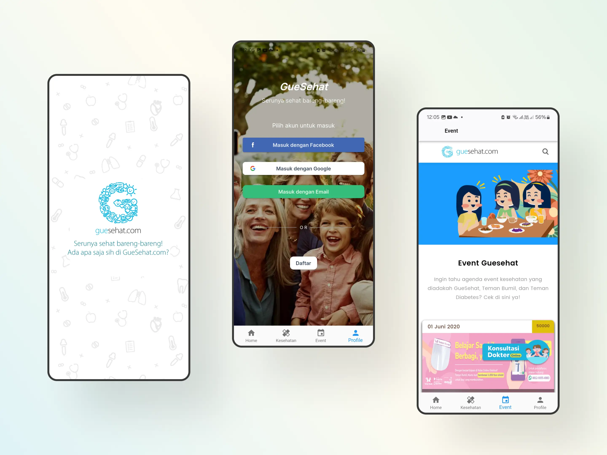
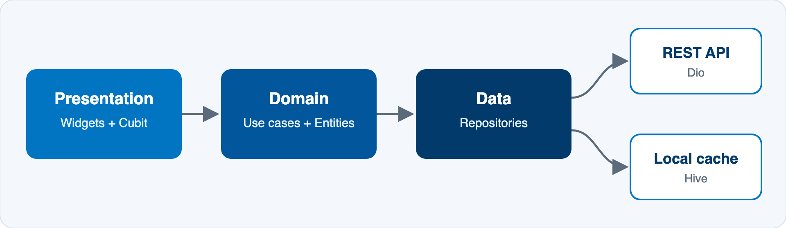

  

  
  

  
  
  

I've been building mobile apps for 8+ years, and Flutter has been my main tool since 2019. I've also shipped native Kotlin and Swift and some React Native, so I can pick whichever fits the job.

Based in Tangerang, Indonesia.

## What I've built and led

- **[Teman Bumil](https://www.nicolin.dev/projects/teman-bumil):** I refactored 70% of its [native Objective-C codebase](https://www.nicolin.dev/projects/teman-bumil-native-legacy), taking crash-free users from 40% to 95-97%, then led the move from two separate native apps (Android and iOS) to one Flutter codebase. It has 1M+ downloads, 150K MAU and 99.5% crash-free sessions. [Google Play](https://play.google.com/store/apps/details?id=com.temanbumil.android) · [App Store](https://apps.apple.com/id/app/teman-bumil-kehamilan-anak/id1298915495)
- **[Bosshire](https://www.nicolin.dev/projects/bosshire):** I built the job portal from first concept to its May 2025 launch, as the only mobile engineer on an 8-person team. It has 10K+ downloads, 2.5K MAU and a 4.8/5 average rating across both stores. [Google Play](https://play.google.com/store/apps/details?id=co.id.bosshire.jobportal) · [App Store](https://apps.apple.com/id/app/bosshire-job-search-connect/id6744142070)
- **[KitaCare](https://www.nicolin.dev/projects/kita-care):** As a freelance mobile engineer in 2023-2024, I refactored a legacy codebase into modular Clean Architecture and built most of the core features, including real-time sync between the Mom and Dad accounts, an AI parenting assistant and QRIS payments. [Google Play](https://play.google.com/store/apps/details?id=com.kitakeluarga.app) · [App Store](https://apps.apple.com/id/app/kitacare/id1634620671)
- **[Teman Diabetes](https://www.nicolin.dev/projects/teman-diabetes):** I contributed to this React Native health app, improving performance and integrating DNurse hardware so blood glucose data syncs without manual entry. [Google Play](https://play.google.com/store/apps/details?id=com.temandiabetes.android) · [App Store](https://apps.apple.com/id/app/teman-diabetes/id1299580913)
- **[Character Lens](https://www.nicolin.dev/projects/character-lens):** I built this one solo. It recognizes handwritten Chinese and Japanese characters on-device with ML Kit, looks them up in an offline dictionary of 60,183 characters, and adds a Gemini explanation grounded in the dictionary entry.
- **[GueSehat](https://www.nicolin.dev/projects/gue-sehat):** I led the team's first production Flutter project in 2019, rebuilding a native Swift iOS app into one Flutter codebase in under 2 months. [Google Play](https://play.google.com/store/apps/details?id=com.guesehat.android) · [App Store](https://apps.apple.com/id/app/guesehat/id1266152551)
- **Leadership:** I led a squad of 5 mobile engineers, then managed a 24-person product engineering team as Technology Manager.
- **Open source:** the Flutter Enterprise Starter Kit has 57 stars.

  
  
  

  
  
  

## What I'm good at

I have created multiple Flutter apps from scratch to publishing on the App Store and Play Store. This includes good knowledge of architecture, state management, offline capabilities, CI/CD and deployment. I have also worked on apps which were already in production. In the case of Teman Bumil, the native app had 40% of crash-free users, which was brought up to 95-97% through my refactoring.

I have led the move of an existing app from two separate native codebases into one. This was done in Teman Bumil, with 99.5% of crash-free sessions.

I have managed a squad and a wider engineering team, and love doing code reviews, mentoring, and making each release less stressful than the previous ones.

If there is an issue in production and no-one knows what is causing it, I'm very happy to dig in with Crashlytics, Flutter DevTools and patience to find out!

## How I like to work

Clean architecture, using BLoC/Cubit or Riverpod, testing business logic and TDD (where appropriate). I document my decisions so that people can understand what I have done. I use Claude Code daily to explore code, plan and review. This increased our release velocity by 30% at Bosshire. I do review any changes made.

## Stack

<b>Full list</b>

- Daily: Flutter, Dart, BLoC/Cubit, Riverpod, Freezed, GetIt, Dio, Firebase, GitHub Actions, Fastlane
- Native and cross-platform: Kotlin (Jetpack Compose), Swift (SwiftUI), Java, Objective-C, React Native
- Data and testing: REST, GraphQL, WebSockets, SQLite, offline caching, flutter_test, bloc_test, mocktail, TDD
- CI/CD and monitoring: GitHub Actions, Jenkins, Fastlane, Crashlytics, Firebase Analytics, Remote Config
- AI: LLM integration, Gemini via Firebase AI Logic, ML Kit, Claude Code
- Also touched: Python, Next.js, React, Go, PostgreSQL

## Open source projects

### [Flutter Enterprise Starter Kit](https://github.com/nicolinx/flutter_enterprise_starter_kit) ⭐ 57

The setup I'd want on day one of a new project: Clean Architecture, Cubit, dependency injection, Firebase Auth, typed error handling, offline REST caching, Dev/Prod flavors, Fastlane, and CI with GitHub Actions. The trade-offs are written up in the repo.

  

### [Character Lens](https://github.com/nicolinx/character-lens)

Draw a Chinese or Japanese character with your finger and look it up. Handwriting is recognized on-device with ML Kit, readings come from an offline dictionary of 60,183 characters, and Gemini writes a short explanation grounded in the dictionary entry. A validator flags example readings the dictionary can't confirm. 630 tests, ADRs, and a [case study](https://github.com/nicolinx/character-lens/blob/main/docs/case-study.md) on how it was built.

  

### [flutter-ai-workflow](https://github.com/nicolinx/flutter-ai-workflow)

A Claude Code plugin with skills for working on Flutter apps: explore, plan, verify, review.

## Currently

- Looking for remote work with a quality-focused team
- Looking for freelance work. Can develop new Flutter apps, perform native-to-Flutter migrations, perform architecture/code reviews, and save troubled apps (either crashing or issues in release).
- Developing tools for working with Claude Code in Flutter.

## Let's work together!

Send me a short message about your project (or team in need of a senior mobile engineer) and I will get back to you quickly. If I am not a good fit, I will let you know.

  
  
  

My hours (UTC+7) overlap well with Singapore, Malaysia, Australia and Europe, and I'm happy to work a few evening hours for US teams.

